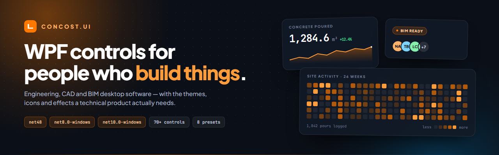
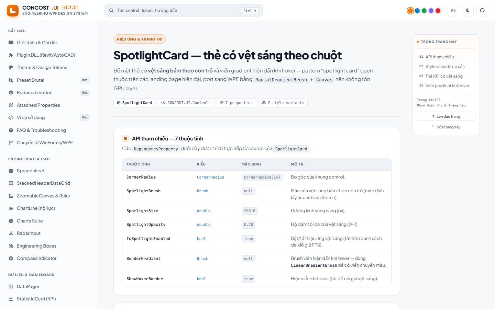

<div align="center">
  

  <p>
    <a href="https://github.com/thanhphuong-dev/CONCOST.UI/releases/latest"></a>
    
    
    
    
  </p>

  <p>
    <a href="https://thanhphuong-dev.github.io/CONCOST.UI/"><b>Documentation</b></a> &nbsp;·&nbsp;
    <a href="docs/GettingStarted.md">Getting started</a> &nbsp;·&nbsp;
    <a href="CHANGELOG.md">Changelog</a> &nbsp;·&nbsp;
    <a href="https://github.com/thanhphuong-dev/CONCOST.UI/releases">Releases</a> &nbsp;·&nbsp;
    <a href="README.vi.md">Tiếng Việt</a>
  </p>
</div>

---

**CONCOST.UI is a WPF component library for software that draws things** — CAD editors, BIM tools, quantity take-off, structural reports. It ships the controls a technical product actually needs: a spreadsheet, a zoomable canvas with ruler, rebar input, KPI dashboards, 20+ visual effects, and a theme system that works inside a Revit or AutoCAD plugin without taking over the host application's resources.

## Why teams pick it

- **Three target frameworks, one API.** `net48`, `net8.0-windows`, `net10.0-windows` from the same source. A project reference picks the matching build automatically, so the same view compiles into a .NET Framework 4.8 AutoCAD plugin and a .NET 8 desktop app.
- **Theming that respects the host.** `ThemeManager.ApplyTheme(this, …)` scopes light/dark, accent and preset to a single view — no `Application` instance, no global resource hijack. That is what makes the library usable inside a Revit add-in.
- **Effects that stay cheap.** Every animation is drawn with `DrawingContext` or a transform — no shaders, no `BlurEffect`, no per-item visual trees — and all of them honour the Windows "Show animations" setting (WCAG 2.2.2).
- **Documented from source.** Property tables and C# samples are generated from the real `DependencyProperty` declarations and validated against the compiled API, so the docs cannot drift from the code.

## What's inside

| Area | Highlights |
| --- | --- |
| **Engineering & CAD** | `Spreadsheet` with formula engine, `StackedHeaderDataGrid`, `ZoomableCanvas` + `Ruler`, internal-force line charts, `RebarInput`, `CompassIndicator` |
| **Data & dashboards** | `StatisticCard`, `OdometerNumber`, `Sparkline`, `HeatmapCalendar`, `AvatarStack`, `Timeline`, `CardCarousel`, `DataPager`, `PropertyGrid` |
| **Input & forms** | 15 controls — `UnitBox` (value + unit + decimals), `NumericUpDown`, `OtpInput`, `PinBox`, `CheckComboBox`, `AutoCompleteTextBox`, `ColorPicker`, `RangeSlider`, `Rating`, `ToggleSwitch` |
| **Navigation & shell** | `NavigationView`, `SideMenu`, `DrawerMenu`, `Breadcrumb`, `StepBar`, `Pagination`, `Transfer`, `TabControl`, `SplitButton`, `CONCOSTWindow` |
| **Feedback & status** | `Dialog`, `Drawer`, `Growl` toast, loading indicators and overlays, `Skeleton` shimmer, `EmptyState`, `Watermark` |
| **Visual effects** | `SpotlightCard`, `TiltCard`, `MagneticHover`, `AuroraBackground`, `BorderBeam`, `ConfettiBurst`, `TypewriterText`, `ScrollReveal`, `ParallaxPanel`, `PulseRing`, `GradientText` and more |
| **Theming** | Light / dark, 8 presets, 5 accent colours, shared design tokens, three surface styles |

## Framework compatibility

| Build | Use it for |
| --- | --- |
| `net48` | .NET Framework 4.8 desktop apps and Revit / AutoCAD plugins on that runtime |
| `net8.0-windows` | .NET 8 desktop apps and plugins |
| `net10.0-windows` | .NET 10 desktop apps and plugins |

Revit and AutoCAD runtime requirements vary by release. Check the requirements for your exact host version, then reference the matching `CONCOST.UI.dll`.

## Install

### A. NuGet package from the release

Download `CONCOST.UI.1.0.1.nupkg` from the [latest release](https://github.com/thanhphuong-dev/CONCOST.UI/releases/latest), then:

```powershell
dotnet nuget add source "C:\path\to\downloads" --name concost-local
dotnet add package CONCOST.UI --version 1.0.1
```

### B. Project reference

```xml
<ItemGroup>
  <ProjectReference Include="path/to/CONCOST.UI/src/CONCOST.UI/CONCOST.UI.csproj" />
</ItemGroup>
```

### C. Prebuilt assembly

```text
src/CONCOST.UI/bin/Release/net48/CONCOST.UI.dll
src/CONCOST.UI/bin/Release/net8.0-windows/CONCOST.UI.dll
src/CONCOST.UI/bin/Release/net10.0-windows/CONCOST.UI.dll
```

> The `net48` build depends on `System.Text.Json` and its transitive dependencies. Use the NuGet package or ship the dependencies from the build output alongside the DLL.

## Quick start

### 1. Merge the theme dictionaries

```xml
<Application.Resources>
    <ResourceDictionary>
        <ResourceDictionary.MergedDictionaries>
            <ResourceDictionary Source="pack://application:,,,/CONCOST.UI;component/Themes/ThemeResources.xaml" />
            <ResourceDictionary Source="pack://application:,,,/CONCOST.UI;component/Themes/Generic.xaml" />
        </ResourceDictionary.MergedDictionaries>
    </ResourceDictionary>
</Application.Resources>
```

### 2. Drop in a control

```xml
<Window x:Class="MyApplication.MainWindow"
        xmlns="http://schemas.microsoft.com/winfx/2006/xaml/presentation"
        xmlns:x="http://schemas.microsoft.com/winfx/2006/xaml"
        xmlns:ui="clr-namespace:CONCOST.UI.Controls;assembly=CONCOST.UI">

    <StackPanel Margin="24">
        <ui:UnitBox Header="Beam width" Value="300" Unit="mm" DecimalPlaces="0" />

        <ui:NumericUpDown Value="25" Minimum="0" Maximum="1000" Increment="5" Suffix=" kN" />

        <ui:SpotlightCard Margin="0,16,0,0">
            <StackPanel>
                <TextBlock Text="Concrete poured" FontSize="12" Opacity=".65" />
                <ui:OdometerNumber Value="1284.6" Format="N1" Suffix=" m³" />
                <ui:Sparkline Values="{Binding WeeklyPour}" Height="40" ShowArea="True" />
            </StackPanel>
        </ui:SpotlightCard>
    </StackPanel>
</Window>
```

### 3. Change the theme at runtime

```csharp
using System.Windows.Media;
using CONCOST.UI.Themes;

ThemeManager.Current.Theme = AppTheme.Dark;
ThemeManager.Current.Preset = ThemePreset.Ocean;
ThemeManager.Current.AccentColor = Color.FromRgb(2, 132, 199);
```

## Hosted in Revit or AutoCAD

A plugin class library has no `App.xaml` and must not touch the host's global resources. Apply the theme to the plugin's root view instead — the resources stay scoped to that `UserControl` or `Window`:

```csharp
using System.Windows.Controls;
using System.Windows.Media;
using CONCOST.UI.Themes;

public partial class SettingsPanel : UserControl
{
    public SettingsPanel()
    {
        InitializeComponent();
        ThemeManager.Current.ApplyTheme(this, AppTheme.Light);
        ThemeManager.Current.ApplyAccentColor(this, Color.FromRgb(2, 132, 199));
    }
}
```

This works without `Application.Current`, and it survives runtime theme changes. See the [Getting Started guide](docs/GettingStarted.md) for the full integration notes.

## Theming

| Preset | Character |
| --- | --- |
| `Default` | Neutral surfaces, orange accent — the everyday look |
| `Ocean` | Cool blues, calm and technical |
| `Forest` | Desaturated greens for long sessions |
| `Sunset` | Warm amber, good for presentation screens |
| `Slate` | Low-chroma greys, CAD-adjacent |
| `Midnight` | Deep navy, high-contrast dark |
| `HighContrast` | Accessibility-first, maximum legibility |
| `Brutal` | Neo-brutalism: cream surfaces, ink borders, electric accent |

Five accent colours ship in the docs site palette (orange, sky, green, violet, red). Switching a preset restores the previous colours when you switch back — the manager snapshots what it overrides.

## Visual effects

All of these are drawn directly, so they cost almost nothing and stay crisp at any DPI.

| Group | Controls |
| --- | --- |
| **Pointer** | `SpotlightCard`, `CursorGlow`, `TiltCard`, `MagneticHover`, `Ripple`, `Magnifier` |
| **Motion & reveal** | `ScrollReveal`, `ParallaxPanel`, `TypewriterText`, `TextReveal`, `CheckMarkDraw`, `ScrollProgressBar`, `MarqueeTicker` |
| **Ambience** | `AuroraBackground`, `GridPattern`, `WaveDivider`, `SnowCanvas`, `Sprite` |
| **Accent & celebration** | `BorderBeam`, `SheenSweep`, `PulseRing`, `GradientText`, `ConfettiBurst` |

`MotionSettings` is the single switch behind all of them. It reads the Windows *Show animations* setting by default, can be muted app-wide with `MotionSettings.ForceDisabled`, and every effect falls back to a static, readable frame instead of freezing mid-animation.

## Documentation

[](https://thanhphuong-dev.github.io/CONCOST.UI/)

The reference is a static wiki — **106 pages**, bilingual **Vietnamese / English**, searchable with `Ctrl K`, with an XAML ↔ C# code inspector on every page. It is fully offline-capable: fonts, icons and syntax highlighting are self-hosted, no CDN.

- **Online:** <https://thanhphuong-dev.github.io/CONCOST.UI/> (`?lang=en` for English)
- [Documentation index](docs/README.md) — page map and maintenance workflow
- [Getting Started](docs/GettingStarted.md) — integration, theming, plugin hosting, build ([Tiếng Việt](docs/GettingStarted.vi.md))
- [Migration Guide](docs/MigrationGuide.md) — WinForms / WPF mapping and deprecation policy ([Tiếng Việt](docs/MigrationGuide.vi.md))
- [Effects roadmap](docs/roadmap/effects-roadmap.md) — what is planned next
- [Changelog](CHANGELOG.md)

## Build from source

**Requirements:** Windows 10+, .NET 8 SDK, .NET 10 SDK. .NET Framework 4.8 reference assemblies are restored automatically for the `net48` target. Visual Studio 2022 with the *.NET desktop development* workload is optional.

```powershell
dotnet restore CONCOST.UI.sln
dotnet build   CONCOST.UI.sln --configuration Release
dotnet test    tests/CONCOST.UI.Tests/CONCOST.UI.Tests.csproj --configuration Release
dotnet run     --project samples/CONCOST.UI.Showcase/CONCOST.UI.Showcase.csproj
```

The Showcase app is the fastest way to see everything: browse by category, switch theme and accent, and open **View XAML** / **View C#** on any demo to copy the exact code.

### Keeping the docs honest

```powershell
python docs/tools/build-props.py     # regenerate property tables from DependencyProperty declarations
python docs/tools/check-xaml.py      # verify every XAML snippet still matches the real API
node   docs/tools/build-index.js     # rebuild the page map and the page → source file map
```

## Repository layout

```text
.
├── docs/                        Documentation wiki — the GitHub Pages source
│   ├── index.html · app.js · style.css     site shell, renderer, design system
│   ├── data/                    page content (VI) + generated API tables
│   │   └── en/                  English overlay for every page
│   ├── assets/                  banner and screenshots used by this README
│   ├── tools/                   build-props.py · check-xaml.py · build-index.js · fetch-fonts.py · banner.html
│   ├── vendor/                  self-hosted fonts, Font Awesome, Prism (offline build)
│   └── roadmap/                 active roadmap and archived plans
├── samples/CONCOST.UI.Showcase/ Interactive control gallery
├── src/CONCOST.UI/              Multi-target WPF library
├── tests/CONCOST.UI.Tests/      Automated tests
├── artifacts/                   release packages and demo builds (git-ignored)
├── CHANGELOG.md · CONTRIBUTING.md · Directory.Build.props · CONCOST.UI.sln
└── README.md · README.vi.md
```

The solution contains one library project. Namespaces such as `CONCOST.UI.Core`, `CONCOST.UI.Themes` and `CONCOST.UI.Controls` organise code inside that assembly — they are not separate DLLs.

## Contributing

Bug reports, feature requests and pull requests are welcome — please read [CONTRIBUTING.md](CONTRIBUTING.md) first. A new control is expected to ship with theme resources, a Showcase demo (with XAML and C# panels), documentation in both languages, and tests where practical.

## License

[MIT](LICENSE) — use it in commercial and open-source products alike.
