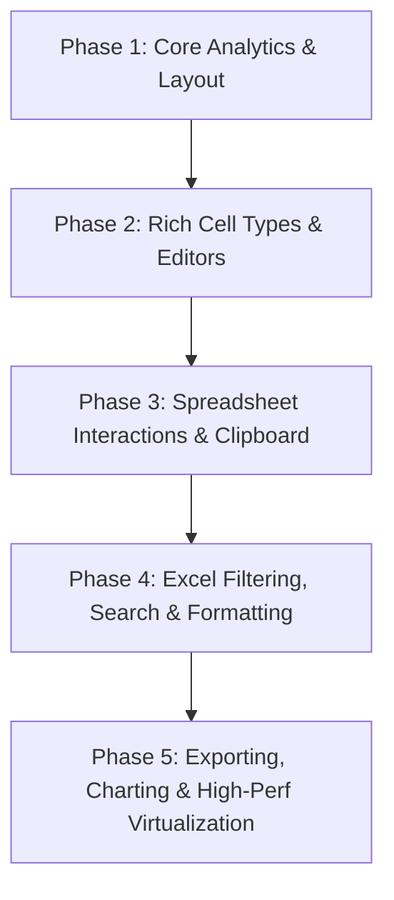

# Implementation Plan: 26 Advanced DataGrid Features (Enterprise Engineering & Spreadsheet Suite)

Kế hoạch tổng thể để nâng cấp `CONCOST.UI` `StackedHeaderDataGrid` thành một bộ điều khiển lưới dữ liệu cấp doanh nghiệp toàn diện, tích hợp đầy đủ 26 tính năng cao cấp từ kiến trúc của **MakroFlexGrid** và **VirtualDataGridWPF**.

---

## 🗺️ Lộ trình Triển khai Theo 5 Giai đoạn (Phases)

---

## 📦 Chi tiết Từng Giai đoạn & 26 Tính năng

### 🟢 GIAI ĐOẠN 1: Core Analytics, Frozen Columns & Cấu trúc nâng cao
> **Mục tiêu**: Bổ sung ngay các tính năng cốt lõi cho tính toán dự toán, cố định cột và chỉ mục dòng.

1. **Bottom Aggregate Footer Panel (Hàng Tổng kết / Thống kê dưới chân bảng)**:
   - Tự động tính: `Sum`, `Average`, `Count`, `Min`, `Max` hoặc Custom Formula cho từng cột con.
   - Cập nhật thời gian thực khi dữ liệu thay đổi hoặc khi bộ lọc lọc bớt dòng.
2. **Column Freezing (Khóa cố định cột Đa vùng)**:
   - Hỗ trợ `FrozenColumnCount`: Khóa cố định các cột bên trái (`No.`, `Mark`, `Status`...) khi cuộn ngang.
   - Khóa cột bên phải (`Right Frozen`).
3. **Row Index Header & Top-Left Select All**:
   - Cột chỉ số dòng tự động đánh số $1, 2, 3...$
   - Ô vuông góc trên cùng bên trái để nhấp chọn toàn bộ bảng.
4. **Hide / Unhide Columns & Auto-Fit Column Width**:
   - Ẩn/Hiện cột linh hoạt qua API hoặc Menu.
   - Double-click vào viền cột để tự động căn chỉnh độ rộng vừa khít nội dung (`Auto-Fit`).

---

### 🟡 GIAI ĐOẠN 2: Bộ sưu tập Cell Types & In-place Editors chuyên dụng
> **Mục tiêu**: Cung cấp các loại ô nhập liệu chuyên dụng cho kỹ thuật xây dựng và quản trị.

5. **NumericCell**: Ô số chuyên dụng có định dạng hàng nghìn `1,000,000`, số chữ số thập phân (`DecimalPlaces`), tiền tệ (`VNĐ`, `$`), nút bấm tăng/giảm Step.
6. **DatePicker & DateTime Cell**: Lịch chọn ngày thả xuống tích hợp định dạng `dd/MM/yyyy`.
7. **ComboBox & AutoComplete Cell**: Danh sách chọn có tìm kiếm lọc nhanh khi gõ phím.
8. **ProgressBar Cell**: Hiển thị thanh tiến độ thực tế theo tỷ lệ phần trăm (0% - 100%).
9. **Status Badge / Tag Cell**: Thẻ trạng thái màu sắc (`Approved`, `Pending`, `Warning`, `Rejected`).
10. **Rating / Star Cell**: Ô đánh giá xếp hạng sao.
11. **ColorPicker Cell**: Ô chọn màu trực tiếp cho cấu kiện/vật liệu.

---

### 🟠 GIAI ĐOẠN 3: Thao tác Spreadsheet & Tương tác Excel
> **Mục tiêu**: Trải nghiệm chọn ô, sao chép và hoàn tác mượt mà như Microsoft Excel.

12. **Excel-like Range Selection (Chọn khối ô chữ nhật)**:
    - Kéo chuột chọn vùng ô (ví dụ `B2:D8`), giữ phím `Ctrl` để chọn nhiều khối ô rời rạc.
13. **Full Clipboard Engine (Copy / Paste 2 chiều với Excel)**:
    - `Ctrl+C` vùng chọn ➔ Dán trực tiếp vào Excel giữ nguyên dòng cột.
    - Copy từ Excel ➔ `Ctrl+V` vào DataGrid tự động điền vào các ô tương ứng.
14. **Fill Handle Drag (Kéo sao chép chuỗi dữ liệu)**:
    - Chấm vuông nhỏ ở góc dưới ô/vùng chọn để kéo tự động điền chuỗi số tăng dần hoặc nhân bản giá trị.
15. **Cell Merging (Gộp ô dữ liệu trong thân bảng)**:
    - Gộp các ô có cùng giá trị theo chiều dọc (ví dụ gộp tên cấu kiện qua các nhịp dầm) hoặc chiều ngang.
16. **Undo / Redo History (`Ctrl+Z` / `Ctrl+Y`)**:
    - Ngăn xếp lịch sử thao tác để hoàn tác khi sửa đổi dữ liệu.

---

### 🔵 GIAI ĐOẠN 4: Bộ lọc Excel Nâng cao, Tìm kiếm & Định dạng Có điều kiện
> **Mục tiêu**: Khả năng phân tích, lọc và làm nổi bật dữ liệu thông minh.

17. **Excel-style Checkbox Filter Dialog**:
    - Popup bộ lọc gồm ô Search nhanh và danh sách Checkbox các giá trị duy nhất (`Select All`, `Clear`).
18. **Numeric Range & Date Range Filter**:
    - Lọc số theo khoảng `[Từ ... Đến ...]`, `Lớn hơn`, `Nhỏ hơn`.
    - Lọc theo mốc thời gian (Tuần này, Tháng này, Khoảng ngày).
19. **Instant Search & Highlight Matching Cells**:
    - Thanh tìm kiếm nhanh trên bảng, tự động bôi sáng (highlight vàng) các ô khớp từ khóa.
20. **Conditional Formatting (Định dạng có điều kiện)**:
    - Quy tắc tô màu tự động theo ngưỡng (Ví dụ: Lỗi tô đỏ, Vượt định mức tô vàng, Thanh dữ liệu Data Bar).

---

### 🟣 GIAI ĐOẠN 5: Xuất Báo cáo, Biểu đồ & Tối ưu Hiệu năng Ảo hóa
> **Mục tiêu**: Hoàn thiện tính năng xuất báo cáo và đảm bảo tải mượt hàng trăm nghìn dòng.

21. **Column Drag & Drop Reordering**:
    - Kéo thả tiêu đề cột để thay đổi vị trí cột, có thanh đánh dấu (`Drop Marker`).
22. **Excel (.xlsx), CSV, PDF Export Engine**:
    - Xuất trực tiếp bảng dữ liệu kèm theo cả cây tiêu đề đa cấp và hàng tổng kết ra file Excel, CSV, PDF.
23. **Quick Charting (Tạo biểu đồ trực quan từ vùng chọn)**:
    - Chọn một vùng số liệu ➔ Click tạo ngay biểu đồ Cột (`Bar Chart`), Đường (`Line Chart`), Tròn (`Pie Chart`).
24. **Context Menu Factory (Menu chuột phải tùy biến)**:
    - Menu chuột phải gồm: Copy, Cut, Paste, Insert Row, Delete Row, Freeze, Filter, Export...
25. **Two-Way Virtualization (Ảo hóa cả Dòng & Cột)**:
    - Chỉ vẽ các dòng và cột đang nằm trong tầm nhìn (`Viewport`), đảm bảo hiển thị 100,000 dòng dữ liệu không giật lag.
26. **Theme & Styling Extensibility**:
    - Đồng bộ hoàn hảo với toàn bộ 10 Theme Palette và Dark/Light mode của CONCOST Design System.

---

## 🛠️ Kế hoạch Thay đổi Code trong Workspace

### Các File sẽ Nâng cấp & Thêm mới:
1. `src/CONCOST.UI/Controls/StackedHeaderDataGrid.cs`:
   - Tích hợp Footer Aggregate, Frozen Column zones, Range Selection, Clipboard, Filter popup.
2. `src/CONCOST.UI/Controls/Cells/`: *(Thư mục mới)*
   - `DataGridNumericColumn.cs`, `DataGridDateColumn.cs`, `DataGridBadgeColumn.cs`, `DataGridProgressColumn.cs`...
3. `src/CONCOST.UI/Themes/Generic.xaml`:
   - Bổ sung ControlTemplate cho Footer Summary Panel, Left/Right Frozen containers, Selection Adorner, Fill Handle.
4. `samples/CONCOST.UI.Showcase/ShowcaseViewModel.cs`:
   - Bổ sung các khu vực Showcase mẫu cho từng tính năng mới.

---

## 🧪 Kế hoạch Kiểm thử & Xác minh (Verification Plan)
- **Kiểm thử tự động**: Build Solution với 0 Error và 0 cảnh báo nghiêm trọng.
- **Kiểm thử tương tác**:
  1. Kiểm tra hàng Footer `Sum`/`Avg` tự động nhảy số khi chỉnh sửa ô hoặc lọc dữ liệu.
  2. Kiểm tra cuộn ngang khi có `FrozenColumnCount="2"`.
  3. Kiểm tra chọn khối ô và nhấn `Ctrl+C` dán vào Excel thật.
  4. Kiểm tra mở Popup Checkbox Filter lọc dữ liệu.
