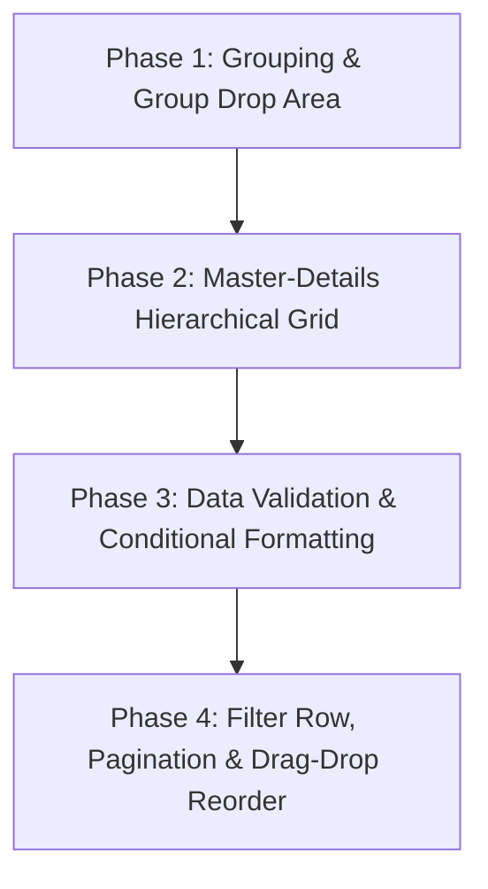

# Implementation Plan: Enterprise-Grade Advanced DataGrid Features (Syncfusion & Telerik Tier)

Kế hoạch nâng cấp và hoàn thiện toàn bộ các tính năng cấp cao còn lại cho `StackedHeaderDataGrid` trong `CONCOST.UI`, đưa bộ điều khiển lưới dữ liệu của chúng ta lên chuẩn ngang hàng với các thư viện thương mại hàng đầu như **Syncfusion SfDataGrid**, **Telerik RadGridView** và **DevExpress GridControl**.

---

## 🗺️ Lộ trình Phát triển 4 Giai đoạn Tiếp theo

---

## 📦 Chi tiết Từng Giai đoạn Phát triển

### 🟢 GIAI ĐOẠN 1: Kéo thả Gom nhóm Dữ liệu & Tính tổng nhóm (`Group Drop Area & Subtotals`)
> **Mục tiêu**: Cho phép người dùng kéo thả tiêu đề cột lên thanh trên cùng để gom nhóm dữ liệu tự động theo dạng cây phân cấp $N$ tầng.

1. **Thanh Gom nhóm (`GroupPanel / GroupDropArea`)**:
   - Vùng kéo thả nằm ở trên cùng của DataGrid với nhãn *"Drag a column header here to group by that column"*.
   - Cho phép kéo tiêu đề cột thả vào, hiển thị dạng Tag/Chip có nút tắt `(x)` để hủy gom nhóm, và hỗ trợ đổi thứ tự nhóm con.
2. **Cấu trúc Nhóm Phân tầng (`Hierarchical Grouping Tree`)**:
   - Tự động chuyển đổi `CollectionViewSource` sang `GroupDescriptions`.
   - Các dòng nhóm (`GroupHeaderRow`) có nút mở rộng/thu gọn `[+]` `[-]` mượt mà.
3. **Tính tổng theo nhóm (`Group Subtotals / Group Summaries`)**:
   - Tự động tính toán tổng số lượng con (`Count`), tổng giá trị (`Sum`), hoặc trung bình (`Avg`) cho từng nhóm dữ liệu con.

---

### 🟡 GIAI ĐOẠN 2: Bảng Mẹ - Bảng Con lồng nhau (`Master - Details Hierarchical View`)
> **Mục tiêu**: Xây dựng cấu trúc lưới phân cấp chuyên sâu cho ngành xây dựng và dự toán (Ví dụ: Bảng mẹ là Dầm, bảng con mở ra danh sách từng thanh thép bên trong).

4. **Nút Mở rộng Dòng (`Row Expander Toggle Button ▶`)**:
   - Cột nút bấm ở đầu mỗi dòng để bật/tắt hiển thị bảng chi tiết con.
5. **Khung Chi tiết Đa dạng (`RowDetailsTemplate / Nested DataGrid`)**:
   - Hỗ trợ nhúng một `StackedHeaderDataGrid` con bên trong dòng mẹ với data binding trực tiếp vào thuộc tính danh sách con (ví dụ `{Binding RebarDetails}`).
   - Cho phép người dùng tùy biến `RowDetailsTemplate` thành dạng Form thông tin, Biểu đồ hoặc Bảng con.
6. **Tối ưu Hiệu năng Render**:
   - Ảo hóa và chỉ render bảng con khi dòng đó được mở rộng (`Lazy Loading`).

---

### 🟠 GIAI ĐOẠN 3: Bắt lỗi Nhập liệu & Định dạng Có điều kiện (`Data Validation & Conditional Formatting`)
> **Mục tiêu**: Đảm bảo tính toàn vẹn dữ liệu kỹ thuật và làm nổi bật các cảnh báo số liệu quan trọng.

7. **Kiểm tra & Bắt lỗi Nhập liệu Trực quan (`Data Validation & Error Tooltip`)**:
   - Tích hợp chặt chẽ với chuẩn `IDataErrorInfo`, `INotifyDataErrorInfo` và `ValidationRules` của .NET.
   - Khi người dùng nhập sai quy chuẩn kỹ thuật (ví dụ: khoảng cách thép $< 50$mm hoặc $> 500$mm, để trống trường bắt buộc):
     - Ô đó tự động phát sáng viền đỏ (`ErrorBorderBrush`).
     - Hiển thị góc cảnh báo đỏ hoặc icon chấm than mini.
     - Rê chuột vào ô hiện **Tooltip giải thích chi tiết nguyên nhân lỗi**.
8. **Định dạng Có điều kiện (`Conditional Formatting Rules Engine`)**:
   - Hỗ trợ thiết lập các quy tắc đổi màu tự động:
     - `Highlight Rule`: Nếu giá trị $< 0$ ➔ Chữ đỏ; Nếu giá trị $>$ ngưỡng ➔ Nền vàng/xanh.
     - `Text Contains Rule`: Nếu trạng thái chứa từ khóa "Warning" ➔ Đổi màu cả dòng hoặc ô.
     - `Data Bars`: Vẽ thanh màu mini trong ô số liệu biểu diễn trực quan độ lớn giá trị.

---

### 🔵 GIAI ĐOẠN 4: Hàng Lọc nhanh, Phân trang & Kéo thả Đổi vị trí Cột
> **Mục tiêu**: Hoàn thiện trải nghiệm người dùng tối ưu khi thao tác với lượng lớn dữ liệu.

9. **Hàng Lọc Nhanh Tức thì (`Filter Row / Excel Auto-Filter Row`)**:
   - Một hàng ô nhập tìm kiếm (`Search Input Row`) nằm ngay dưới Header.
   - Gõ từ khóa vào cột nào ➔ Lập tức lọc dữ liệu của cột đó trong thời gian thực.
10. **Thanh Phân trang Dữ liệu (`Data Pager / Pagination Control`)**:
    - Bộ điều khiển phân trang dưới chân bảng: `|<  <  1  2  3  4  5  >  >|` kèm lựa chọn số dòng trên mỗi trang (10, 25, 50, 100 dòng/trang).
11. **Kéo thả Đổi vị trí Cột (`Column Drag & Drop Reordering`)**:
    - Kéo giữ tiêu đề cột để di chuyển sang vị trí mới, hiển thị thanh chỉ thị thả cột (`Drop Marker Line`).

---

## 🛠️ Các File Nâng cấp & Thêm mới

1. `src/CONCOST.UI/Controls/StackedHeaderDataGrid.cs`:
   - Bổ sung `GroupPanel`, `RowDetails` Master-Detail hooks, Validation visual states, Reordering drag events.
2. `src/CONCOST.UI/Controls/DataGridFeatures/`:
   - `DataGridGroupHelper.cs`: Xử lý logic kéo thả nhóm và GroupDescriptions.
   - `DataGridValidationHelper.cs`: Bắt lỗi và hiển thị Error Tooltip.
   - `DataGridConditionalFormatting.cs`: Động cơ quy tắc định dạng có điều kiện.
   - `DataPager.cs`: Component phân trang độc lập tái sử dụng được.
3. `src/CONCOST.UI/Themes/Generic.xaml`:
   - Bổ sung ControlTemplate cho `GroupPanel`, `GroupHeaderRow`, `RowExpanderButton`, `DataPager`.
4. `samples/CONCOST.UI.Showcase/`:
   - Bổ sung các khu vực Showcase mẫu cho Gom nhóm, Master-Details lồng nhau, Validation và Conditional Formatting.

---

## 🧪 Kế hoạch Kiểm thử (Verification Plan)
- **Tự động**: Build Solution đảm bảo 0 Error và 0 Warning nghiêm trọng.
- **Tương tác**:
  1. Thử kéo thả tiêu đề cột lên thanh Group Panel ➔ Kiểm tra dữ liệu gom nhóm và tính subtotal.
  2. Bấm nút mở rộng `▶` ở đầu dòng ➔ Kiểm tra bảng con lồng nhau hiển thị mượt mà.
  3. Nhập dữ liệu sai quy chuẩn ➔ Kiểm tra viền đỏ và Error Tooltip.
  4. Thử đổi giá trị số ➔ Kiểm tra Conditional Formatting tự động đổi màu.
